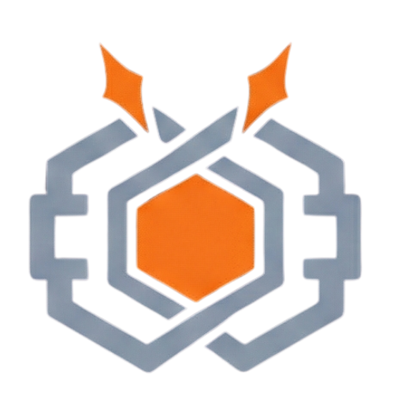

<p align="center">
  
</p>

# forge-orchestrator

[](STAGE) [](https://registry.modelcontextprotocol.io) [](LICENSE.md) [](https://github.com/nxtg-ai/forge-orchestrator/releases/tag/v1.7.0) [](https://github.com/nxtg-ai/forge-orchestrator/actions) [](https://github.com/nxtg-ai/forge-orchestrator) [](https://crates.io/crates/forge-orchestrator)

**Stage: Alpha.** The Forge plugin and orchestrator are in alpha. On 2026-10-15 (UTC) a separate NXTG.AI team (product-oracle) ran the pre-registered core-job test on a clean install of the plugin (v3.14.0) and the orchestrator (forge 1.7.0). The test passed; each repeated check passed 3 of 3 (run 7). The evidence is attached to the forge-plugin v3.14.0 release. No SLA; interfaces may change without notice.

**Orchestration for Claude Code on shared repos, with Codex CLI and Antigravity CLI (`agy`) as task runners — single Rust binary, zero deps.**

Multi-agent inside a single tool works fine. Claude Code runs 20 subagents and they stay aligned because the tool manages that orchestration internally. The problem is multi-tool: several AI coding tools on the same repo with no shared state. That's what the orchestrator solves: today for Claude Code, with Codex CLI and Antigravity CLI (`agy`) as task runners. The orchestrator launches `agy` as a task runner; what else Forge does on `agy` is being measured (build B1, target 2026-10-27).

It adds file locking, knowledge capture, task planning, drift detection, and multi-tool orchestration to your development workflow. The tools read from and write to a single state directory. A 12-tool MCP server exposes the full orchestration state to any connected AI client, and can create, claim and complete tasks.

The orchestrator exists because I ran two AI tools on the same codebase and watched them fail in the same ways human teams fail. Claude refactored a module. Codex updated tests against the pre-refactor interface. Both saved. Tests failed. Neither tool knew the other existed. I'd spent 23 years watching this exact scenario with talented human teams. The solution was always the same: orchestration infrastructure.

## Install

```bash
curl -fsSL https://forge.nxtg.ai/install.sh | sh
export PATH="$HOME/.local/bin:$PATH"   # this shell only; new shells already have it
forge init
```

The installer installs Forge v1.7.1, the pinned release, not whichever release is newest. It puts `forge` in `~/.local/bin` (change it with `FORGE_INSTALL_DIR`) and adds that directory to your PATH with one guarded line in `~/.profile`, `~/.bashrc` and, if you have zsh, `~/.zshenv`. Set `FORGE_NO_MODIFY_PATH=1` to leave your shell files alone.

If the `claude` CLI is on your PATH, the installer then adds forge's MCP tools to Claude Code, using only that CLI: it adds and refreshes the `nxtg-forge` marketplace (`nxtg-ai/forge-plugin`), updates `nxtg-forge@nxtg-forge` if you already have it, and installs the companion plugin `nxtg-forge-orchestrator@nxtg-forge`. It prints one line per change and changes no Claude configuration any other way. Without `claude`, or if a step fails, it prints the commands for you to run and still exits 0. Set `FORGE_NO_CLAUDE_PLUGIN=1` to skip it.

Single binary. No runtime dependencies.

## Connect Codex CLI to the MCP server

Register the orchestrator's MCP server with Codex CLI, then check that Codex lists it:

```bash
codex mcp add forge -- forge mcp
codex mcp list
```

This writes the entry to `~/.codex/config.toml`:

```toml
[mcp_servers.forge]
command = "forge"
args = ["mcp"]
```

The server works on the project in the directory it starts in. To pin one project, bind it when you register: `codex mcp add forge --env FORGE_PROJECT_ROOT=/path/to/project -- forge mcp`. Checked with codex-cli 0.162.1: `codex mcp list` shows `forge` enabled over stdio, and the server answers `tools/list` with its 12 tools. A tool call made from inside a Codex session has not been measured yet (build B1).

## Quick Demo

Four commands from zero to task board:

```bash
# 1. Initialize — creates .forge/ directory with state, event log, knowledge base
forge init

# 2. Configure the AI brain — choose 'openai' (needs API key) or 'rule-based' (free)
forge config brain openai

# 3. Generate tasks — reads your SPEC.md or README, creates dependency-aware task graph
forge plan --generate

# 4. See the result — task board with assignments, dependencies, and project health
forge status
```

From here you can:
- `forge run` — execute tasks headlessly (autonomous mode, great for CI)
- `forge dashboard --pty` — launch the TUI dashboard with interactive agent panes


## Past Result: Stargate Mode (before v1.6.1)

From a 94-line specification, an earlier version of the orchestrator coordinated three AI coding tools to build a complete CLI toolkit. That run drove the retired Gemini CLI; since v1.6.1 the adapter launches Antigravity CLI (`agy`) instead, and the run has not been re-measured.

```
SPEC.md (94 lines) → forge plan --generate → 15 tasks

Claude Code:  6 design tasks     → completed
Codex CLI:    6 implementation   → completed
Gemini CLI:   3 test/doc tasks   → completed   (pre-1.6.1 adapter)

Result: 5,306 lines of working code
        10 auto-committed git entries
        13 Python files (CLI + tests)
        Zero file conflicts
```

Three companies. Three tools. One orchestrator. One command:

```bash
forge dashboard --pty
```

## What You Get

| Feature | What It Does |
|---------|-------------|
| File locking | Exclusive locks prevent tools from editing the same file simultaneously |
| Knowledge flywheel | Captures decisions, patterns, learnings across tools. Auto-classified and searchable. |
| Plan generation | `forge plan --generate` decomposes specs into dependency-aware task graphs |
| Drift detection | Compares completed tasks against SPEC.md. Needs the `openai` brain; the default rule-based brain does not score drift |
| Task board | Dependency-tracked tasks, tool assignment, progress monitoring |
| Multi-tool adapters | Claude Code (MCP stdio); Codex CLI and Antigravity CLI (`agy`) as task runners (filesystem). Codex CLI can also register the MCP server (see below) |
| TUI dashboard | `forge dashboard`: live tool panes, task status, lock state |
| Headless mode | `forge run`: autonomous execution for CI/CD pipelines |
| MCP server | 12 tools accessible by any connected AI tool via stdio, including `forge_create_task` |

## Key Commands

```bash
forge init                     # Initialize Forge in a project
forge plan --generate          # Generate task plan from spec
forge dashboard                # Live TUI dashboard
forge dashboard --pty          # TUI with interactive agent panes (Stargate)
forge run                      # Headless autonomous mode
forge status                   # Current state summary
forge verify                   # Run automated acceptance tests
forge uat                      # Interactive UAT test runner
forge ship                     # Release ceremony: changelog, archive, tag
```

## Architecture

The orchestrator is the policy core of Forge. All governance rules, file locks, and orchestration logic live here. The plugin (L1: Vibe Coder) and UI (L3: Ship Lord) are adapter surfaces. They present the orchestrator's state through different interfaces but don't make policy decisions.

```
┌──────────────────────────────────────┐
│        forge-orchestrator            │
│        (Rust)                        │
│                                      │
│  File locking · Task planning        │
│  Knowledge · Governance · MCP        │
│  Multi-tool adapters                 │
│                                      │
│  Policy enforced here.               │
│  Nowhere else.                       │
└───────────┬──────────────────┬───────┘
            │                  │
   ┌────────┴────────┐  ┌────┴────────┐
   │  forge-plugin   │  │  forge-ui   │
   │  (L1 Safety)    │  │  (L3 MC)    │
   │  Claude Code    │  │  React      │
   │  adapter        │  │  dashboard  │
   └─────────────────┘  └─────────────┘
```

**Communication**: `.forge/` filesystem + MCP stdio. No daemon. No database. State is files.

**Tool adapters**: Claude Code uses MCP stdio. Codex CLI and Antigravity CLI (`agy`) run tasks through filesystem conventions. The `agy` adapter keeps the agent id `gemini` in task files, config keys and MCP arguments, so existing projects keep working. Each tool reads its own config format. No Forge-specific configuration language.

## How File Locking Works

File locking exists because I've watched teams lose days to conflicting edits.

When Claude Code starts editing a file, the orchestrator acquires an exclusive lock in `.forge/locks/`. Codex CLI requesting the same file is queued with a notification of who holds the lock. Locks include timeouts (crashed tools don't hold locks forever) and deadlock detection.

The test suite covers concurrent access, timeout behavior, multi-adapter locking, and edge cases.

## How the Knowledge Flywheel Works

The knowledge flywheel exists because I've watched decisions evaporate between sprints.

Every decision, pattern, and learning from tool sessions is captured in `.forge/knowledge/`. Entries are auto-classified by category. Search across sessions and across tools. Knowledge captured during a Claude Code session is available to Codex CLI the next day.

After a week, the system knows your conventions better than you remember them. New sessions start with context instead of from scratch.

## Upgrade Path

The TUI dashboard shows everything. Forge UI shows it better.

Visual dashboards. Governance HUD. Real-time agent collaboration network. And the Infinity Terminal: sessions that survive browser close, network drops, and server restarts. If you've lost a 3-hour agent session to a disconnected SSH pipe, you know why this matters.

```bash
git clone https://github.com/nxtg-ai/forge-ui && cd forge-ui && npm install && npm run dev
```

## Links

- [Forge Product Page](https://forge.nxtg.ai)
- [Forge Plugin](https://github.com/nxtg-ai/forge-plugin) (L1: Vibe Coder)
- [Forge UI](https://github.com/nxtg-ai/forge-ui) (L3: Ship Lord)
- [Documentation](https://forge.nxtg.ai/forge/docs)
- MCP Registry: `mcp-name: io.github.nxtg-ai/forge-orchestrator`

## License

Source available under the [Functional Source License 1.1 (FSL-1.1-ALv2)](./LICENSE.md). Converts to Apache License 2.0 on 2028-03-18. See [LICENSE.md](./LICENSE.md) for full terms.
