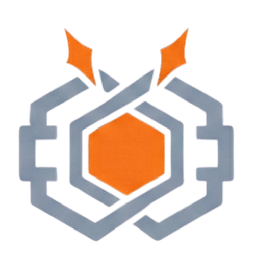

<p align="center">
  
</p>

# forge-orchestrator

[](STAGE) [](https://registry.modelcontextprotocol.io) [](LICENSE.md) [](https://github.com/nxtg-ai/forge-orchestrator/releases/tag/v1.8.0) [](https://docs.rs/forge-orchestrator/1.8.0/forge_orchestrator/) [](https://github.com/nxtg-ai/forge-orchestrator/actions) [](https://github.com/nxtg-ai/forge-orchestrator) [](https://crates.io/crates/forge-orchestrator)

**Stage: Alpha.** The Forge plugin and orchestrator are in alpha. On 2026-10-15 (UTC) a separate NXTG.AI team (product-oracle) ran the pre-registered core-job test on a clean install of the plugin (v3.14.0) and the orchestrator (forge 1.7.0). The test passed; each repeated check passed 3 of 3 (run 7). The evidence is attached to the forge-plugin v3.14.0 release. No SLA; interfaces may change without notice.

**Orchestration for Claude Code on shared repos, with Codex CLI and Antigravity CLI (`agy`) as task runners — single Rust binary, zero deps.**

Multi-agent inside a single tool works fine. Claude Code runs 20 subagents and they stay aligned because the tool manages that orchestration internally. The problem is multi-tool: several AI coding tools on the same repo with no shared state. That's what the orchestrator solves: today for Claude Code, with Codex CLI and Antigravity CLI (`agy`) as task runners. The orchestrator launches `agy` as a task runner; Forge makes no other claim about `agy`.

It adds file locking, knowledge capture, task planning, drift detection, and multi-tool orchestration to your development workflow. The tools read from and write to a single state directory. A 12-tool MCP server exposes the full orchestration state to any connected AI client, and can create, claim and complete tasks.

The orchestrator exists because I ran two AI tools on the same codebase and watched them fail in the same ways human teams fail. Claude refactored a module. Codex updated tests against the pre-refactor interface. Both saved. Tests failed. Neither tool knew the other existed. I'd spent 23 years watching this exact scenario with talented human teams. The solution was always the same: orchestration infrastructure.

## Install

```bash
curl -fsSL https://forge.nxtg.ai/install.sh | sh
export PATH="$HOME/.local/bin:$PATH"   # this shell only; new shells already have it
forge init
```

The installer installs Forge v1.8.0, the pinned release, not whichever release is newest. It puts `forge` in `~/.local/bin` (change it with `FORGE_INSTALL_DIR`) and adds that directory to your PATH with one guarded line in `~/.profile`, `~/.bashrc` and, if you have zsh, `~/.zshenv`. Set `FORGE_NO_MODIFY_PATH=1` to leave your shell files alone.

If the `claude` CLI is on your PATH, the installer then adds forge's MCP tools to Claude Code, using only that CLI: it adds and refreshes the `nxtg-forge` marketplace (`nxtg-ai/forge-plugin`), updates `nxtg-forge@nxtg-forge` if you already have it, and installs the companion plugin `nxtg-forge-orchestrator@nxtg-forge`. It prints one line per change and changes no Claude configuration any other way. Without `claude`, or if a step fails, it prints the commands for you to run and still exits 0. Set `FORGE_NO_CLAUDE_PLUGIN=1` to skip it.

Single binary. No runtime dependencies.

## Connect Codex CLI to the MCP server

Register the orchestrator's MCP server with Codex CLI, then check that Codex lists it:

```bash
codex mcp add forge -- forge mcp
codex mcp list
```

This writes the entry to `~/.codex/config.toml`:

```toml
[mcp_servers.forge]
command = "forge"
args = ["mcp"]
```

The server works on the project in the directory it starts in. To pin one project, bind it when you register: `codex mcp add forge --env FORGE_PROJECT_ROOT=/path/to/project -- forge mcp`. Checked with codex-cli 0.162.1: `codex mcp list` shows `forge` enabled over stdio, and the server answers `tools/list` with its 12 tools. A tool call made through this registration from inside a Codex session has not been measured.

## Quick Demo

Four commands from zero to task board:

```bash
# 1. Initialize — creates .forge/ directory with state, event log, knowledge base
forge init

# 2. Configure the AI brain — choose 'openai' (needs API key) or 'rule-based' (free)
forge config brain openai

# 3. Generate tasks — reads your SPEC.md or README, creates dependency-aware task graph
forge plan --generate

# 4. See the result — task board with assignments, dependencies, and project health
forge status
```

From here you can:
- `forge run` — execute tasks headlessly (autonomous mode, great for CI)
- `forge dashboard --pty` — launch the TUI dashboard with interactive agent panes


## Past Result: Stargate Mode (before v1.6.1)

From a 94-line specification, an earlier version of the orchestrator coordinated three AI coding tools to build a complete CLI toolkit. That run drove the retired Gemini CLI; since v1.6.1 the adapter launches Antigravity CLI (`agy`) instead, and the run has not been re-measured.

```
SPEC.md (94 lines) → forge plan --generate → 15 tasks

Claude Code:  6 design tasks     → completed
Codex CLI:    6 implementation   → completed
Gemini CLI:   3 test/doc tasks   → completed   (pre-1.6.1 adapter)

Result: 5,306 lines of working code
        10 auto-committed git entries
        13 Python files (CLI + tests)
        Zero file conflicts
```

Three companies. Three tools. One orchestrator. One command:

```bash
forge dashboard --pty
```

## What You Get

| Feature | What It Does |
|---------|-------------|
| File locking | A task names the files it touches; a claim through MCP or `forge run --task … --agent …` is refused while another task holds one of them |
| Knowledge flywheel | Captures decisions, patterns, learnings across tools. Auto-classified and searchable. |
| Plan generation | `forge plan --generate` decomposes specs into dependency-aware task graphs |
| Drift detection | Compares completed tasks against SPEC.md. Needs the `openai` brain; the default rule-based brain does not score drift |
| Task board | Dependency-tracked tasks, tool assignment, progress monitoring |
| Multi-tool adapters | Claude Code (MCP stdio); Codex CLI and Antigravity CLI (`agy`) as task runners (filesystem). Codex CLI can also register the MCP server (see below) |
| TUI dashboard | `forge dashboard`: live tool panes, task status, lock state |
| Headless mode | `forge run`: autonomous execution for CI/CD pipelines |
| MCP server | 12 tools accessible by any connected AI tool via stdio, including `forge_create_task` |

## Key Commands

```bash
forge init                     # Initialize Forge in a project
forge plan --generate          # Generate task plan from spec
forge dashboard                # Live TUI dashboard
forge dashboard --pty          # TUI with interactive agent panes (Stargate)
forge run                      # Headless autonomous mode
forge status                   # Current state summary
forge verify                   # Create verify tasks for completed build tasks
forge uat                      # Interactive UAT test runner
forge ship                     # Ship phase: changelog, archive, clean state for the next cycle
```

Every command and its options, as the binary prints them. CI regenerates this block from `forge --help` and fails if it differs:

<!-- forge-help:start (generated by .github/scripts/readme-cli.py --write; do not edit) -->
```text
$ forge --help
Forge orchestrates Claude Code on shared repos, with Codex CLI and Antigravity CLI (agy) as task runners: file locking, knowledge capture and a shared task board.

Usage: forge [OPTIONS] <COMMAND>

Commands:
  init       Initialize Forge in a project — scaffold .forge/, detect AI tools
  plan       Show or generate the master plan
  status     Show orchestration status — task board, agent activity, governance
  run        Execute tasks headlessly. Omit --task/--agent for autonomous parallel mode
  start      Start autonomous orchestration — run all tasks with auto-claim/complete
  sync       Reconcile state — update summaries, render adapter configs, check governance
  mcp        Start the MCP server (stdio transport) — AI tools connect to query/update state
  dashboard  Live TUI dashboard — task board, agent output, event log
  doctor     Aggregate health verdict — quality, release debt, and drift in one fail-closed exit code
  pod        Declarative tmux pod management — start, stop, and recover multi-pane agent pods
  verify     Generate verify subtasks for completed build tasks
  uat        Interactive UAT — describe issues naturally, capture findings
  ship       Ship phase — generate changelog, archive artifacts, clean state for next cycle
  uninstall  Uninstall Forge — remove binary and optionally project data
  config     Get or set configuration values
  help       Print this message or the help of the given subcommand(s)

Options:
      --project <PROJECT>
          Path to the project root (defaults to current directory)

          [default: .]

  -h, --help
          Print help (see a summary with '-h')

  -V, --version
          Print version
```
<!-- forge-help:end -->

## Use as a library

Since v1.8.0, the crate also builds a library, `forge_orchestrator`, for tools that read or write a project's `.forge/` directory without running `forge`. Its documented surface is `forge_orchestrator::core`: project state and file locks, tasks, the event log, the knowledge base and the plan. The rest of the crate is the binary's internals, hidden from the docs. Like the binary, the library is alpha, and its API may change.

```toml
[dependencies]
forge-orchestrator = "1.8"   # the first version with the library
```

```rust
use forge_orchestrator::core::task::{Task, TaskManager};

let tasks = TaskManager::new(".forge");
tasks.create_task(&Task::new("T-001", "Parse the config", "Read forge.toml into Config"))?;
for task in tasks.list_tasks()? {
    println!("{} {:?} {}", task.id, task.status, task.title);
}
```

API docs: https://docs.rs/forge-orchestrator. To build them locally: `cargo doc --open` in a checkout.

Runnable examples, run in CI against the built binary:

- [`examples/task_board.rs`](examples/task_board.rs): print a project's task board from `.forge/`.
- [`examples/capture_knowledge.rs`](examples/capture_knowledge.rs): capture a decision and list that category.
- [`examples/mcp_stdio.rs`](examples/mcp_stdio.rs): talk to `forge mcp` as an MCP client: initialize, list the 12 tools, create a task.

```bash
cargo build && cargo run --example mcp_stdio -- target/debug/forge /tmp/demo
cargo run --example task_board -- /tmp/demo
```

## Architecture

The orchestrator holds Forge's shared state: tasks, file locks, knowledge and the event log. The plugin (L1: Vibe Coder) adds Claude Code commands, skills and hooks, and its guard hooks run inside Claude Code. The UI (L3: Ship Lord) is a separate React dashboard.

```
┌──────────────────────────────────────┐
│        forge-orchestrator            │
│        (Rust)                        │
│                                      │
│  File locking · Task planning        │
│  Knowledge · Governance · MCP        │
│  Multi-tool adapters                 │
│                                      │
│  Shared state lives here.            │
│  Guard hooks live in forge-plugin.   │
└───────────┬──────────────────┬───────┘
            │                  │
   ┌────────┴────────┐  ┌────┴────────┐
   │  forge-plugin   │  │  forge-ui   │
   │  (L1 Safety)    │  │  (L3 MC)    │
   │  Claude Code    │  │  React      │
   │  adapter        │  │  dashboard  │
   └─────────────────┘  └─────────────┘
```

**Communication**: `.forge/` filesystem + MCP stdio. No daemon. No database. State is files.

**Tool adapters**: Claude Code uses MCP stdio. Codex CLI and Antigravity CLI (`agy`) run tasks through filesystem conventions. The `agy` adapter keeps the agent id `gemini` in task files, config keys and MCP arguments, so existing projects keep working. Each tool reads its own config format. No Forge-specific configuration language.

## How File Locking Works

File locking exists because I've watched teams lose days to conflicting edits.

Each task lists the files it touches. A claim through the `forge_claim_task` MCP tool or single-task `forge run --task <id> --agent <agent>` first checks those files against the locks held in `.forge/state.json`. If any overlap, the claim is refused, and the refusal names the task and agent that hold them; otherwise the files are recorded as locked by that task. `forge start` and the dashboard record locks the same way when they launch a task, but do not check for overlap first. Autonomous `forge run` (no `--task`) neither checks for overlap nor records locks. Finishing the task releases its locks.

The lock governs claims, not edits: it does not stop a tool from writing a file. Locks have no timeout: if the process that took a lock dies, the lock stays in the state file. The state file is read and rewritten without a cross-process lock, so two claims made at the same moment can both succeed.

## How the Knowledge Flywheel Works

The knowledge flywheel exists because I've watched decisions evaporate between sprints.

Decisions, patterns, learnings and research captured through `forge_capture_knowledge` are stored in `.forge/knowledge/`, one directory per category, and classified automatically. Any tool connected to the MCP server can search them with `forge_get_knowledge`, in a later session as well as the current one.

## Forge UI

[forge-ui](https://github.com/nxtg-ai/forge-ui) is a separate React dashboard for Forge, released on its own; its README states its stage. To run it from source:

```bash
git clone https://github.com/nxtg-ai/forge-ui && cd forge-ui && npm install && npm run dev
```

## Links

- [Forge Product Page](https://forge.nxtg.ai)
- [Forge Plugin](https://github.com/nxtg-ai/forge-plugin) (L1: Vibe Coder)
- [Forge UI](https://github.com/nxtg-ai/forge-ui) (L3: Ship Lord)
- [Documentation](https://forge.nxtg.ai/docs)
- MCP Registry: `mcp-name: io.github.nxtg-ai/forge-orchestrator`

## License

Source available under the [Functional Source License 1.1 (FSL-1.1-ALv2)](./LICENSE.md). Converts to Apache License 2.0 on 2028-03-18. See [LICENSE.md](./LICENSE.md) for full terms.
